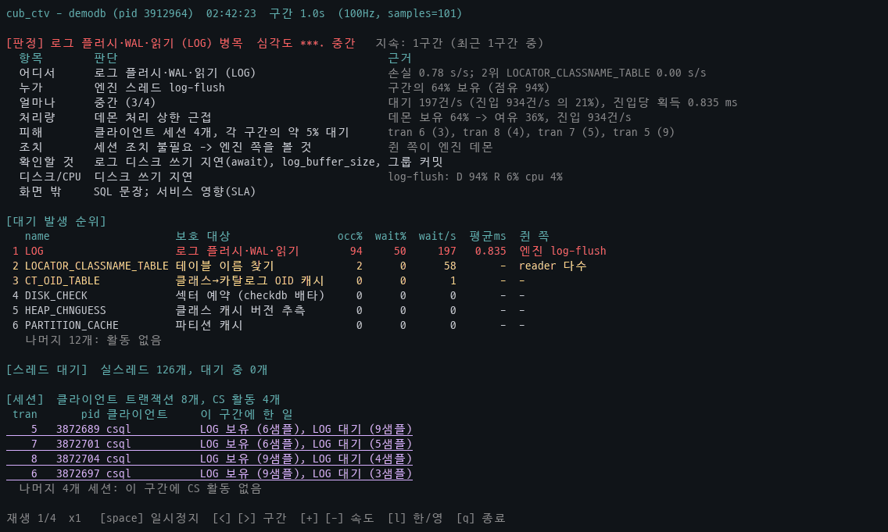

# cub_ctv — CUBRID 크리티컬 섹션 뷰어 (Critical Section Viewer)

실행 중인 `cub_server`의 **크리티컬 섹션(서버 R/W 래치)**, **동기화 프리미티브 통계 풀**,
**트랜잭션·스레드 신원**을 서버에 접속하지 않고 보여주는 단독 도구.
`/proc/<pid>/maps` 와 대상 메모리 읽기(`/proc/<pid>/mem` pread, 여러 작은 범위는 `process_vm_readv` — 둘 다 같은 ptrace 읽기 권한·읽기 전용)만 사용한다 — 락 0, ptrace attach 0, SQL 접속 0.

- 정적 바이너리 1개(`./build.sh`, 약 1.2MB). CUBRID 설치·라이브러리·배포판 무관.
- CUBRID 헤더를 하드코딩하지 않는다. 심볼은 대상이 매핑한 libcubrid.so에서, 구조 기하는 런타임
  불변식으로 결정하며, 검증에 실패하면 **거부하거나 해당 정보만 강등**한다. 검증된 위치에서 고정 거리로
  유도하는 오프셋 몇 개는 §9 유도식 항목에 열거한다.



위 그림(`t9-replay.gif`)은 `tests/t9_quick_trace.sh demodb 15 4 --ko` 가 경합 부하 중에 기록한 라이브 4구간을
`--replay` 로 터미널에서 재생한 화면이다(구간당 1.5초). 판정 표·대기 발생 순위·스레드 대기·세션 블록이 구간마다 갱신된다.
화면 구성은 §4.2, 판정 해석은 §5.

## 누구를 위한, 어느 상황을 위한 도구인가 (Who and When)

**한 문장**: 커밋·접속·아카이브 경로에서 서버가 직렬화되거나 아예 멈췄을 때, 접속 없이 "누가 무엇을 쥐고 누가
기다리는지"를 사람이 읽을 수 있는 판정으로 내놓는 **기술지원용 도구**이고, 그 밖의 성능 문제에서는 "여기는
아니다"를 빨리 확인해 주는 **배제 도구**다.

| 대상 | 쓰는 이유 |
|---|---|
| 기술지원·DBA (1순위) | "서버가 느리다/안 받는다"는 호출을 받았을 때, 접속 없이 10초 안에 "엔진 내부 래치에서 막히는가, 누가 쥐고 있는가"를 확인하고 세션 문제인지 엔진·디스크 문제인지 가른다 |
| 엔진 개발자 | CS 경합을 시계열로 재고(PSTAT에 없음), 코드 변경 전후를 같은 부하로 비교한다 |
| 장애 보고서를 쓰는 사람 | `--record`로 그 순간을 남겨 나중에 어디서나 같은 화면으로 재생하고, `--dump`로 그 순간의 정보 전부를 첨부한다 |

| 상황 | 보이는 CS | 도구가 답하는 것 |
|---|---|---|
| 커밋 폭주, 로그 플러시·체크포인트 스톨 | LOG | 쥔 쪽이 로그 플러시 데몬인지 클라이언트인지, 플러시 관련 진입 몇 %가 얼마나 기다리는지, 초당 손실 (일반 커밋 자체의 대기는 CS 밖 — 플러시 데몬 뒤에서 기다림; postpone 이 있는 커밋·롤백은 로그 읽기로 LOG 를 지남) |
| 접속 폭주, DDL 반복 | LOCATOR_CLASSNAME_TABLE, TRAN_TABLE, ACCESS_STATUS, CT_OID_TABLE | 고회전인지 실제 막힘인지, 어느 세션들이 몰리는지 |
| 아카이브 로그 경합 (백업·CDC) | LOG_ARCHIVE | 누가 아카이브를 잡고 있는지 |
| **서버 무응답** | 무엇이든 | 접속이 안 되는 상태에서도 판독되는 유일한 수단. CS에 걸려 있으면 홀더와 대기자가 보이고, CS가 깨끗하면 "CS 밖(페이지 래치·락·I/O)"으로 범위를 좁힌다 |

**아닌 것**: 느린 질의, 행 락 경합, 페이지 래치 경합, 버퍼 부족 — 11.x에서 자주 겪는 문제의 대부분은 CS 밖에 있다.
그런 경우 이 도구는 "CS 경합 없음"이라고만 답하고, 그 답 자체가 쓸모다(한 영역을 지웠으니). 서버가 살아 있고 한 번
보는 것으로 족하면 `SHOW CRITICAL SECTIONS`로 충분하다 — 이 도구의 추가 가치는 시계열·신원·대기 체인·무접속·재생이지
숫자 자체가 아니다.

## 1. 빌드

```bash
./build.sh          # → ./cub_ctv (glibc 정적 링크; 불가 환경이면 동적 빌드로 폴백, --dynamic 이면 동적)
```

요구: gcc, glibc-static(정적 빌드 시). 외부 라이브러리 없음.

## 2. 사용

```bash
cub_ctv -l                               # 실행 중인 cub_server 목록 (인자 없이 실행하면 도움말)
cub_ctv demodb                           # 스냅샷: CS 표 + 트랜잭션 표 + RWLOCK/RMUTEX/MUTEX 풀 집계
cub_ctv demodb -i                        # 라이브(--interactive): tty면 풀스크린, 파이프면 스크롤
cub_ctv demodb -i --interval 3 --hz 200
cub_ctv demodb --detail [LOG|1]          # CS별 세로 레코드(전 필드·대기 체인 전체)
cub_ctv demodb -i --detail | cat         # 파이프 라이브: 윈도우마다 움직인 CS를 세로 레코드로
cub_ctv demodb --trans                   # 트랜잭션 신원만 (무접속 tranlist)
cub_ctv demodb --json                    # 스냅샷/--trans=JSON 1문서, -i=윈도우당 1줄
cub_ctv demodb --wide | --narrow         # 소유자 블록을 항상 한 줄 / 항상 연속행 (기본: 폭 자동)
cub_ctv demodb --plain                   # 색상 없이 (기본: 터미널이면 색상; 세션 표 반전·밑줄은 유지)
cub_ctv demodb -i --record f.rec         # 보면서 기록 (스냅샷이면 1장, 라이브면 구간마다)
                                         #   또는 라이브 화면에서 [r]: <pid>_<db>_<시각>.ctv 녹화 시작/중지, [l]: 한/영 전환, [q]: 종료
cub_ctv --replay f.rec                   # 어디서든 다시 보기; 터미널이면 space/←→/+-/q 로 조작
cub_ctv --replay f.rec --detail LOG      # 보기 옵션은 기록 때와 달라도 됨
cub_ctv demodb --dump f.json             # 디테일 덤프: 이 순간 읽을 수 있는 정보 전부 (재생 불가)
cub_ctv demodb --ko | --en               # 메시지 언어 (기본: LANG 자동)
cub_ctv --help                           # 옵션 도움말
tests/t9_quick_trace.sh demodb           # 이 서버에서 추적이 되는지 15초 확인 (부하+화면+판정)
```

대상은 DB 이름 또는 PID. `--dump`는 `-i`와, `--replay`는 `-i`/`--dump`/`--record`와 함께 쓸 수 없다.

### 2.1 기록 파일과 디테일 덤프 (Record vs Detail dump)

| | 기록 파일 `--record` | 디테일 덤프 `--dump` |
|---|---|---|
| 목적 | 본 화면을 나중에, 어느 환경에서나 다시 보기 | 그 순간 cub_ctv 가 알아낼 수 있는 정보를 빠짐없이 남기기 |
| 담는 것 | 화면을 그린 값: CS 18행(상태·카운터·라이브 점유율/대기율 집계), 소유자 신원, 소유자 스레드 번호, 대기 체인, 구간 중 세션별 보유/대기 활동, 트랜잭션 표, 풀 그룹(스냅샷 기록만) | 위 전부 + 구조체 오프셋·심볼 주소·라이브러리 경로, 트랜잭션 슬롯 전부(해제·빈 슬롯 포함), 사용 중 스레드 엔트리 전부, 풀 엔트리 하나하나, 강등 사유 |
| 모드 | 스냅샷(1장), 라이브(구간마다 1장) | 스냅샷 전용 |
| 형식·크기 | 줄 단위 텍스트, 스냅샷 약 4KB / 라이브 구간당 약 4KB (클라이언트 32개 기준, 신원·활동 줄 수에 비례) | JSON 1문서, 약 100KB |
| 재생 | `--replay` (라이브는 기록 당시 간격으로; 터미널에서는 일시정지·구간 이동·속도 키) | **불가** — `--replay` 가 이유를 밝히고 거부 |

- 재생은 기록된 값을 라이브와 같은 출력 코드에 넣어 화면을 다시 그린다. 같은 보기 옵션이면 라이브 출력과
  그 기록의 재생 출력이 바이트 단위로 같다(스크롤·스냅샷 출력 기준, tests/t7; 터미널 요약 화면은 하단 조작 안내
  줄만 다름). `--detail`·`--trans`·`--json`·`--narrow`·`--ko` 는 재생할 때 바꿔 골라도 된다.
- 라이브 기록은 구간마다 파일에 내려 쓰므로 Ctrl-C 로 끝내도 완성된 구간은 남는다. 끊긴 마지막 구간은
  재생 때 경고 후 건너뛴다.
- 두 파일 모두 클라이언트 신원(사용자·호스트·IP·프로그램명·OS 로그인명·클라이언트 pid)과 대상 pid·DB 이름·
  라이브러리 경로·스레드 이름·OS tid 를 담고, 덤프는 호스트명·커널 버전·실행 파일 경로도 담는다. 외부로 보낼 때 유의한다.

## 3. SHOW CRITICAL SECTIONS와 같은 순간 비교

같은 DDL churn 부하에서 수 ms 간격으로 캡처한 실제 출력이다.

```text
# SHOW CRITICAL SECTIONS (csql, DBA 접속) — 12컬럼, 한 행 230자+
Index  Name   Num_holders  Num_waiting_readers  Num_waiting_writers  Owner_thread_index  Owner_tran_index  Total_enter_count  Total_waiter_count  Waiting_promoter_thread_index  Max_waiting_msecs  Total_waiting_msecs
    1  'LOG'  '1 writer'                     0                    3                4275                 2              38106               17999                           NULL             70.945  ...

# cub_ctv demodb (무접속)
ix  name                      state     waitR waitW  tran   nenter   nwait  reenter  total_ms   max_ms
 1  LOG                       1 writer      0     3     2    38106   17999      115   69404.6   70.945
      | owner  DBA@dbhost01 csql pid=3570914 login=cubrid ip=10.0.0.79  thr=4275  trid=141050
      | wq     thr=4227(tran 1 DBA csql) -> thr=4239(tran 3 DBA csql)  [2 of 3 waiting]
```

| SHOW 컬럼 | cub_ctv | 비고 |
|---|---|---|
| Index / Name | ix / name | 동일 |
| Num_holders | state | 동일 토큰(`none` / `N readers` / `1 writer`) |
| Num_waiting_readers / writers | waitR / waitW | 동일(순간값) |
| Owner_thread_index | `thr=` | 동일 번호 체계 |
| Owner_tran_index | tran + `owner` 블록 | 번호에 더해 **누구인지**(user@host program pid login ip trid) |
| Total_enter_count / Total_waiter_count | nenter / nwait | 같은 엔진 카운터 |
| Waiting_promoter_thread_index | `wq` | promoter 대기 큐 → writer 대기 큐 순서의 **전체 체인** |
| Max_waiting_msecs / Total_waiting_msecs | max_ms / total_ms | 동일 |
| — | reenter, occ%/wait%/enter/s/wait/s(라이브), 트랜잭션 표, JSON, 재생 | cub_ctv만 |

수치는 같은 엔진 값이다(max_ms 70.945 동일). 순간 홀더는 ms 단위로 교대하므로 1회 스냅샷끼리는
달라 보일 수 있고, 그 그림은 라이브 윈도우(점유%·대기%)가 준다.

## 4. 화면 읽는 법

### 4.1 스냅샷 (CS 표)

| 컬럼 | 의미 |
|---|---|
| state | 순간 점유: `none` / `N readers` / `1 writer` |
| waitR / waitW | 대기 중 reader / writer 수 (순간값) |
| tran | writer 점유 트랜잭션 인덱스 (`-` = 없음) |
| nenter / nwait / reenter | 누적 획득 시도 / 무한대기 발생 / 재진입 (엔진이 항상 수집; `;info csstat` 실행 시 0으로 리셋) |
| total_ms / max_ms | 누적 / 최대 **획득 지연** (보유 시간 아님) |
| `-` 표기 | 통계 블록이 검증을 통과하지 못한 행 |

표 아래 `스레드 대기:` 한 줄은 실스레드 수와 지금 무엇을 기다리는 스레드가 몇 개인지(락·페이지 래치·빈 버퍼·크리티컬 섹션 …)를 준다. CS 표가 조용한데 서버가 느리면 여기서 다음에 볼 곳이 보인다.

소유자 블록: 행 끝에 `[user@host program pid=N thr=T trid=X]  {wq: thr=A(tran 1), .. [n of waitW waiting]}`.
행+블록이 터미널 폭을 넘으면 블록을 들여쓴 연속행(`| owner`, `| wq`)으로 내린다(파이프 출력은 `--narrow`가
아니면 한 줄). `[system log-flush thr=T]`처럼 시스템 트랜잭션은 OS 스레드 이름(`log-flush`, `pgbuf-page-flus`, `vacuum` …)과 함께 나온다.

표 헤더·상태 토큰은 정렬을 위해 항상 영문(식별자), 안내·오류 메시지만 `--ko`/LANG에 따라 한글.

### 4.2 라이브 (`-i`)

기본 100Hz로 CS 배열(2.9KB)을 샘플링하고 `--interval`마다 표시한다. 대기 큐가 있으면 그 큐의 엔트리를 칸당 1회 읽고(머리가 바뀌면 CS당 20Hz 상한, 같은 머리는 0.25초마다), 쓰기 보유 중인 CS 의 owner 스레드는 procfs `task/<tid>/stat` 을 스레드당 20Hz 상한으로 읽는다. 보유·대기로 목격한 클라이언트 트랜잭션은 그 슬롯의 클라이언트 pid(4B)를 트랜잭션당 20Hz 상한으로 읽어 함께 남긴다(구간 중 슬롯 재사용 구분). 구간마다 트랜잭션 신원·스레드 대기 사유·로그 장치 diskstats 를 한 번씩 모아 읽는다(비용 표: PR.md 부록 B.2).

| 컬럼 | 의미 |
|---|---|
| occ% / occ-bar | 윈도우 중 점유 상태로 관측된 샘플 비율 (`#` 10칸 = 100%) |
| wait% | 대기자가 있던 샘플 비율 |
| enter/s, wait/s | 누적 카운터의 구간 미분 (u32 wrap 보정, 누적 획득 시간(total_elapsed)과 진입 수가 함께 줄면 리셋으로 보고 새 값을 증분으로); 대기 발생 행은 `<-- WAIT` |
| 소유자 블록 | 윈도우 중 **목격된** writer 소유자·대기 큐를 기억해 표시 — µs 점유도 포착. 체인 끝은 현재 큐면 `[n of N waiting]`, 지금 큐가 비어 구간 중 목격한 체인을 보이거나 큐가 waitW 보다 길면 `[n seen]`. 목격한 클라이언트가 구간 중 접속을 끊어 슬롯이 다른 클라이언트에게 넘어갔으면 현재 클라이언트가 아니라 목격한 클라이언트를 `disconnected` 로 표시(신원을 모르면 `pid N`) |

위는 파이프 출력이다. tty에서는 대체 화면에 **요약 화면**을 제자리 갱신한다(맨 위 그림 `t9-replay.gif` 가 그 실제 화면이다): `[판정]`(심각도가 가장 높은 CS — 같으면 손실이 큰 순, 쥔 쪽,
대기 건수·진입당 획득 ms·초당 손실(엔진 누적 획득 시간의 구간 차), 대기 세션, 확인할 것) → `[대기 발생 순위]`(활동 CS를 심각도→손실 순으로, 보호 대상 설명·쥔 쪽)
→ `[스레드 대기]`(실스레드가 지금 기다리는 것: 락·페이지 래치·빈 버퍼·CS …) → `[세션]`(CS를 쥐거나 기다린 트랜잭션과 한 일, 대기=밑줄·보유=반전; 구간 중 접속을 끊은 클라이언트는 `(disconnected)` 를 앞에 붙여 따로 한 줄). 판정 표에는 쥔 스레드의 OS 이름과 `디스크/CPU` 행(D/R 상태 비율·CPU, 로그 장치 await/util)이 들어간다. 한/영 전환은 `--ko`/`--en`, 색상은 `--plain`으로
해제. 재생 화면도 같다. 화면은 그리는 터미널 크기에 맞춰 배치한다(80칸 이상이면 폭을 넘는 줄 없음, 재생은 재생하는 터미널 기준). 형식은 docs/usage.md §2.2.
파이프/리다이렉트면 활동 행만 스크롤 출력한다.

### 4.3 `--detail` (세로 레코드)

```text
*************************** 1. LOG ***************************
state            : 1 writer         waitR/waitW : 0 / 2
owner tran       : 1 (trid 149180)
owner client     : DBA@dbhost01  program csql  login cubrid  ip 10.0.0.79  pid 3584914
owner thread     : 4275
waiting writers  : thr 4239 (tran 2 DBA csql)
                   [1 of 2 waiting]
nenter / nwait   : 48532 / 23224      reenter : 153
total / max wait : 147482.9 ms / 154.167 ms
```

### 4.4 트랜잭션 표 (`--trans`, 스냅샷 하단)

`idx trid user program login host client_ip cpid` — `cubrid tranlist`와 같은 신원 + login/IP.
해제된 슬롯(trid = NULL_TRANID)은 tranlist와 마찬가지로 표시하지 않는다. trid 오프셋이 검증되지
않은 빌드에서는 trid를 `-`로 찍고 해제 슬롯 필터를 끈다.

### 4.5 풀 집계 (스냅샷 하단)

`[pool] RWLOCK` / `[pool] RMUTEX`(있으면 `MUTEX`) 그룹: 같은 이름의 인스턴스 수 `n`, 획득 시도 합 `nenter`, 최대 획득 지연 `max_ms`.
`SHOW CRITICAL SECTIONS` 에 없는 항목이다. 풀의 CSECT 엔트리는 CS 표와 같은 통계라 다시 찍지 않는다. 엔진이 이 객체들의 대기는
집계하지 않아 nwait 컬럼은 없다.

### 4.6 `layout:` 줄

```text
layout: stride=160B count=18 stats_off=152 (runtime-probed)  threads=4314
```

프로빙 결과와 강등 상태를 1회 보고한다. 강등 예: `[trid not validated (I-8)]`,
`[no transaction table (I-6/I-7): I-6 all_tdes]`, `[no thread entries (I-14)]`. 거부 시에는 실패한 불변식 id를 오류에 싣는다:
`cannot validate SYNC_CRITICAL_SECTION layout (I-3 stats pointer) - refusing to guess` (ELF 단계 거부는 사유 문장만).

## 5. 해석 가이드 (판정)

| 조건 | 판정 | 다음 행동 |
|---|---|---|
| ① wait% > 0 ∨ wait/s > 0 (`<-- WAIT`) | 경합 발생 | ②/③으로 분류 |
| ② occ% 높음 + enter/s 낮음 | **장기 점유** | `[system]`=체크포인트/로그 플러시(정상), 클라이언트면 `owner`·`thr=`로 특정 |
| ③ enter/s 높음 (occ%는 µs 점유에선 잡음) | **고회전** | 워크로드 측 대응 |
| ④ 누적 nwait 큼 + max_ms 큼 (스냅샷) | 과거 병목 이력 | 재현 시 라이브로 포착, `--json`으로 상시 수집 |
| ⑤ waitW > 0 지속 + writer 고정 + enter/s ≈ 0 | **행(hang) 의심** | `owner`/`wq` 체인으로 주체 특정 — 접속 불능 상태에서도 판독됨 |

| CS | 올리는 활동 | 실측 패턴 |
|---|---|---|
| LOG | 로그 플러시(디스크 쓰기), 더티 페이지 쓰기 전 WAL 보장, 체크포인트, 아카이브, 롤백·postpone·세이브포인트·CDC·HA 전송의 로그 페이지 읽기(reader) — 일반 로그 기록은 별도 뮤텍스(prior list)라 여기 안 잡힘 | DML 시 최상위. `[system]` 장기 점유 = 로그 플러시(정상). 클라이언트가 writer면 대개 롤백·postpone 등의 로그 읽기(prior list 내리기)나 명시적 페이지 flush 의 WAL 보장 |
| LOG_ARCHIVE | 아카이브 로그 접근 | CDC/log 소비자·백업이 대기 유발 |
| LOCATOR_CLASSNAME_TABLE | 클래스명→OID 조회 | 접속 폭주·autocommit DML·DDL churn에서 급증 |
| TRAN_TABLE / ACCESS_STATUS | 트랜잭션 슬롯 할당·반납(접속·종료), 체크포인트 / 로그인 | 접속률 지표 (트랜잭션마다 진입하지 않음) |
| HEAP_CHNGUESS | 클라이언트별 클래스 캐시 버전(CHN) 추측표 | 짧은 트랜잭션을 반복하는 병렬 DML·DDL에서 대기 발생 |
| CT_OID_TABLE / PARTITION_CACHE | 클래스 OID→카탈로그 레코드 OID 캐시 / 파티션 | DDL, 파티션 DML |

읽기 SELECT가 CS에 거의 안 보이는 것은 정상이다 — 읽기는 페이지 버퍼 래치(BCB)를 타며 이 체계 밖이다(예외: 로그에서
MVCC 이전 버전을 읽는 경우는 LOG 를 reader 로 지난다).

## 6. 동작 원리 (요약)

1. `/proc/<pid>/maps`에서 libcubrid.so 매핑과 경로를 찾고, 자체 ELF 파서로 `.dynsym`/`.symtab`에서
   `csectgl_Critical_sections`, `sync_Stats`, `log_Gl`, `cubthread::Manager`를 조회한다(파일 크기 대비 경계검사).
2. CS 배열 기하(stride·count·stats 슬롯)는 `cs_index` 수열과 `cs->name == stats->name` 불변식으로 프로빙하고,
   rwlock/tran/owner/대기큐 오프셋은 stats 슬롯에서 유도한 뒤 대기 수 범위·대기 큐 포인터 범위·`rwlock<0 ⇒ owner≠0`
   (어긋난 CS ≤ 1)로 교차검증한다(I-4). 강등 중에는 rwlock>0이어도 owner·tran_index가 남으므로 역방향은 검사하지 않는다.
3. 트랜잭션 테이블은 `tdes[k].tran_index == k` 불변식, CLIENTIDS는 "문자열 6개 + pid" 패턴(libstdc++ COW/SSO
   양 ABI)과 증인 투표로, 스레드 엔트리 배열은 `index == 1,2,3,4` 수열로, `m_id` 는 "비0 고유 주소 개수 ≈ 프로세스 스레드 수" 후보 중
   OS tid 검사(I-17)가 확인하는 것으로 잠근다. 대기 체인은 `next_wait_thrd`를 따라가며 매 홉이 배열 내 엔트리인지 검증한다.
4. 스레드의 OS tid 는 `m_id` 가 가리키는 struct pthread 안에서 `/proc/<pid>/task` 집합과 일치하는 유일 오프셋으로(I-17), 대기 사유는 엔트리의 `resume_status` 를 값 분포와 CS 대기 큐 닻으로(I-18) 잠근다. 그 뒤 스레드 상태는 procfs(`task/<tid>/stat`·`comm`, `diskstats`)로 읽고, 스레드 집합이 바뀐 초에만 m_id·tid 표를 대상 메모리에서 gather 2회로 다시 만든다(엔트리 수 × 8B + 실스레드 × 4B).
5. 대기 체인의 `next_wait_thrd` 는 resume_status 뒤에서 전 엔트리가 0 또는 다른 엔트리 포인터인 후보 중 실제 포인터를 보인 것으로 잠근다(I-19).
6. 불변식 I-0~I-20 원장은 PR.md에 있다. 실패 시 `REFUSE(id)`로 거부하거나 해당 정보만 강등한다.
7. 큰 판독 버퍼가 호스트 THP 컴팩션을 유발하지 않도록 프로세스 THP를 끈다(`prctl`).

## 7. 소스 구조 (src/, 27파일 약 12,100줄)

| 층 | 파일 | 역할 |
|---|---|---|
| — | `ctv.h` | 공용 타입·상수·전역, 모듈별 프로토타입 |
| 기반 | `ctv_text.c` | UTF-8 길이·열 폭·열 기준 자르기/채우기, 외부 문자열 정화, FNV 해시 |
| 기반 | `ctv_mem.c` | 대상 메모리 판독의 유일한 경로(pread, gather, 필드 gather, 문자열, 이름 캐시) |
| 기반 | `ctv_field.c` | **프로브 필드 상태기계** `FIELD`: 미확정/잠정/확정, 런타임 집계(`field_sight`), 기각 목록(`field_reject`), 재기회 프로빙(`field_probe`) |
| 기반 | `ctv_sched.c` | **재시도 일정** `SCHED`(빠른 회차 2→64초, 느린 단계 5분, 앞당김, 재시작)과 최소 간격 게이트 `every` |
| 기반 | `ctv_msg.c` | 한/영 메시지, `die`/`warn`/`warnf`, 강등 비트의 유일한 쓰기 함수 `deg_set` |
| 기반 | `ctv_os.c / ctv_proc.c / ctv_elf.c` | procfs(task·stat·comm·로그 장치), cub_server 목록, ELF 심볼·매핑 베이스 |
| 대상 해석 | `ctv_cs.c` | CS 배열 레이아웃 프로브(거부 사유를 반환), 행 해독, 대기 큐 머리(promoter→writer) |
| 대상 해석 | `ctv_tran.c` | TDES·CLIENTIDS 프로브, 신원 판독·캐시 |
| 대상 해석 | `ctv_thr_probe.c` | 배열 위치를 찾고(I-14) 각 필드의 후보 오프셋을 고르는 판독·탐색 함수(FIELD 상태는 바꾸지 않음) |
| 대상 해석 | `ctv_thr.c` | 스레드 필드의 수명(FIELD 6개 + SCHED, `thr_publish` 가 `thr_geom` 의 유효 플래그·필드 오프셋의 유일한 쓰기 — 배열 위치·간격·개수는 탐색 함수가 기록), m_id·tid 표, 대기 체인, 대기 사유, 덤프 |
| 대상 해석 | `ctv_pool.c` | sync_Stats 풀 체인 순회·집계 |
| 프레임 | `ctv_frame.c` | 프레임(`VIEW_FRAME`) 캡처(스냅샷·라이브 구간·표만; 풀은 스냅샷에서 `view_capture_pool`)와 렌더러용 질의(`view_*`) |
| 프레임 | `ctv_rec.c` | 기록 형식: **줄 규칙 표**로 읽기·검증·색인·이동(쓰기는 `view_record_frame`), 신원 키프레임 |
| 표시 | `ctv_verdict.c` | 판정 계산: CS 지표·순위, 보유자, 지속성 이력, `VERDICT` 구조체(텍스트 없음) |
| 표시 | `ctv_term.c` | 터미널: 크기·색·raw 모드·키·신호·대기(모든 tty 상태 소유) |
| 표시 | `ctv_rows.c` | 표 행·소유자 블록·세로 레코드·트랜잭션 표(텍스트) |
| 표시 | `ctv_json.c` | JSON 문서 |
| 표시 | `ctv_screen.c` | 요약 화면: `VERDICT` 를 그림, 터미널 폭·높이에 맞춤 |
| 표시 | `ctv_present.c` | 한 프레임을 모드별로 출력(요약 화면·스크롤 행·트랜잭션 표·JSON) |
| 표시 | `ctv_dump.c` | `--dump` 디테일 덤프 |
| 실행 | `ctv_sampler.c` | 라이브 표본(`LIVE_WIN`): 점유·대기·활동·큐 순회·OS 표본 |
| 실행 | `ctv_live.c` | 라이브 루프: 시작 / 표본 1회 / 구간 마감 / 키 / 종료 단계 함수 |
| 실행 | `ctv_replay.c` | 재생 루프(스크롤·대화형) |
| 실행 | `cub_ctv.c` | 인자, 대상 선택, 흐름 조립 |

상세 문서: `docs/usage.md`(옵션·출력 예시·해석), `docs/critical-sections.md`(**크리티컬 섹션 동작 설명 — 신입 엔지니어용**: 잠금 층 비교, 18종이 지키는 것, 진입·대기·재진입·강등 규칙, 통계의 뜻, 커밋/접속/DDL 예시), `docs/architecture.md`, `docs/limitations.md`, `docs/build.md`, `docs/spec/`(**재구현 명세** — 소스 없이 같은 동작·출력·기록 형식을 다시 작성할 수 있는 수준의 모듈별 상세; `00-overview.md` 부터).

## 8. 테스트

| 스크립트 | 내용 | 서버 |
|---|---|---|
| `tests/t2_show_compare.py` | `SHOW CRITICAL SECTIONS` 전·후 값 사이에 들어오는지 비교 + 자기영향 0 검증 (설치 경로는 서버 실행 파일에서 찾음; `CUB=`·`CUB_CTV_TOOL=` 로 지정 가능) | 필요 |
| `tests/t4_trans_check.sh` | 해제 슬롯(trid −1) 미표시, 접속 중 csql 클라이언트가 양성 trid 로 표시되고 `cubrid tranlist` 에도 있음 (접속 불가 시 SKIP) | 필요 |
| `tests/t5_replay.sh` | `tests/fixtures/*.rec`(실기록) 를 보기 6종으로 재생 → 골든 출력과 바이트 비교 + JSON 유효성 | **불필요** |
| `tests/t6_view_roundtrip.sh` | 대기 체인·특수문자 이름·풀을 주입한 프레임을 기록→재생, 두 출력 동일 | **불필요** |
| `tests/t11_ident_delta.sh` | 신원 키프레임·변화분(`K`/`I`/`X`) 기록이 전체 신원 기록과 같은 트랜잭션 표로 재생, 역방향·무작위 구간 이동의 신원이 순차 판독과 일치 | **불필요** |
| `tests/t12_field_sched.sh` | 프로브 필드 상태기계(잠금·집계·기각·재기회)와 재시도 일정(빠른/느린/앞당김/재시작) 규칙 | **불필요** |
| `tests/t13_verdict.sh` | 고정물 각 프레임의 판정 수치(`VERDICT`, 텍스트 이전)를 골든과 비교 | **불필요** |
| `tests/t14_slot_reuse.sh` | 구간 중 클라이언트가 떠나고 같은 트랜잭션 슬롯을 다른 클라이언트가 받은 기록을 재생 → 소유자 블록·대기 큐 홉·요약 화면 세션이 그 구간에 목격된 클라이언트(`disconnected` 표시)로 나오고 현재 클라이언트로 바뀌지 않음 | **불필요** |
| `tests/t15_screen_fit.py` | 기록을 여러 크기의 가상 터미널(80×24 ~ 200×50, 60×20)에서 한/영으로 재생 → 요약 화면이 스크롤되지 않고(줄바꿈된 줄도 화면 줄로 셈), 80칸 이상이면 터미널 폭을 넘는 줄이 없음 | **불필요** |
| `tests/t7_record_equiv.sh` | 실서버에서 라이브 출력 = 그 기록의 재생 출력(파이프 출력, 스냅샷·라이브), 디테일 덤프 JSON 검증과 재생 거부 | 필요 |
| `tests/t8_replay_keys.py` | 가짜 터미널에서 재생 키(일시정지·구간 이동·속도·종료), 요약 화면 세션 강조, 색상·`--plain`·파이프 무이스케이프 | **불필요** |
| `tests/t10_os_probe.sh` | `--dump` 의 OS tid 가 모두 `/proc/<pid>/task` 의 서로 다른 tid 이고 개수가 스레드 수 −1 의 ±8 이내, 이름 일치(I-17), 대기 사유 코드 범위·스냅샷 줄(I-18) | 필요 |
| `tests/t9_quick_trace.sh` | **빠른 확인**: 짧은 부하 중 라이브 요약 화면 1구간 캡처 + 기록 → 판독·판정·대기 세션 식별 PASS/FAIL, 화면 출력(docs/usage.md §3) | 필요 |
| `tests/check_msg_pairs.py` | 한/영 메시지 쌍의 printf 지시자 동일성(정적) | 불필요 |
| `tests/demo_contention.sh` | CS 인덱스(0–17)별 표적 경합 유발 또는 스큐 부하(기본), 전/후 증분 판정 | 필요 |

## 9. 한계

- 관측 범위 = `critical_section.c` 체계에 등록된 프리미티브. 페이지 버퍼 BCB 래치, lock-free, lock_manager
  트랜잭션 락은 범위 밖. 과녁은 접속 폭주, 로그 플러시·체크포인트 스톨, 아카이브 로그 경합이다.
- 엔진 통계의 한계: `nwait`는 무한대기 경로만 집계, `elapsed`는 획득 지연(보유 시간 아님), `tran_index`는
  writer만 설정(reader 주체 불명), RWLOCK/RMUTEX는 nwait 미집계, 누적 카운터는 u32. 엔진의 `nenter` 증가는
  잠금 밖이라 경합 시 일부 유실되며, demote·promote 도 진입으로 센다.
- `;info csstat` 는 엔진 누적 통계를 0으로 리셋한다(CS·RWLOCK·RMUTEX; 그 출력은 Total Wait 와 Total Reenter 열이
  뒤바뀌어 찍히는 엔진 결함도 있다). cub_ctv 는 누적 획득 시간(total_elapsed)과 진입 수가 함께 줄면 리셋으로 보고 그 구간 증분을 새 값으로 계산하지만, 스냅샷의
  누적값(nenter·nwait·max_ms 등)은 리셋 이후 값이다.
- 무락 판독: 카운터 ±1, total/max 대기시간은 찢긴 판독에서 일시적으로 최대 +1,000ms. occ%는 100Hz 격자라 µs
  점유에선 잡음(장기 점유 판정에만 사용). 개별 enter 이벤트는 미포착.
- 유도식: CS 의 rwlock·owner·promoter 큐·writer 큐 위치(stats −96/−16/−24/−32B, I-4 로 교차검증), CS 의 tran
  (stats −8B, 별도 검사 없음), SYNC_STATS 카운터 오프셋(nenter@16·nwait@20·nreenter@24·total@32·max@48 고정, type·name 만
  검증), 스레드 엔트리 tran_index(index+28B 또는 +20B 중 검증 통과 1개, I-15), 통계 풀 청크 꼬리(I-12). 별도 검사가
  없는 두 항목 외에는 교차검증을 통과해야만 사용하고 실패하면 거부하거나 강등한다. `cubthread::Manager`는 .symtab 로컬 심볼이라 **스트립된 빌드에서는 스레드 정보가
  강등**된다.
- Linux(/proc)·x86_64 전용, 대상과 동일 호스트. Yama `ptrace_scope=1`(Ubuntu/Debian 기본)에서는 사실상 root가
  필요하다. 커널은 4KB 페이지마다 대상의 mmap_lock을 읽기 모드로 잡는다(1회 4~8µs, 주소공간 변경과만 경합).
  라이브 판독량 약 0.3MB/s·시작 약 6.7MB 에서는 모의 대상 실험상 영향이 검출되지 않는다 — 근거와 위험도는 PR.md 부록 B.
